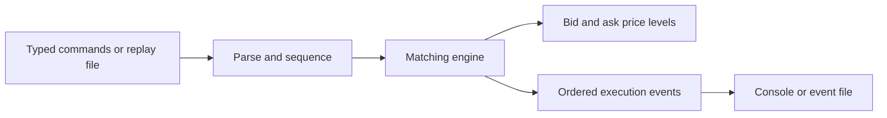
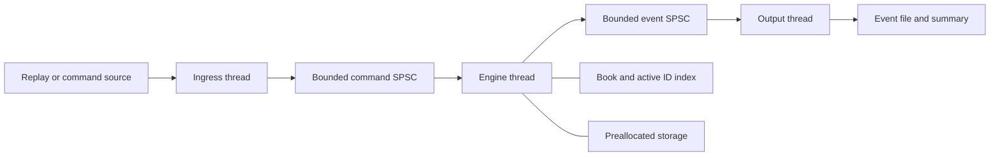

# System architecture

## System boundary and status

HFT Lab is a single-process exchange simulator. It accepts order commands, maintains one
synthetic instrument's limit order book and emits ordered execution events. A later
simulated client consumes market updates and submits risk-checked orders through the same
ingress path. The [project plan](project-plan.md) defines delivery milestones.

Only the FIFO price level, shared value types, build and CLI scaffold are implemented
today. The matching core and subsequent components below describe the target system.
They do not imply that network transport, fixed-capacity storage or concurrency exists.

## Component model

### Initial runtime: sequential replay

The current CLI has a fixed typed command sequence. Replay parsing and event files are
planned. In this runtime, ingestion, application and event collection execute on one
thread. There are no queues or locks between them.

### Concurrent runtime: bounded transport

SPSC means exactly one producer and one consumer. The ingress thread is the sole command
queue writer, the engine is its sole reader and sole event-queue writer, and the output
thread is the sole event-queue reader. Only the engine owns mutable matching state.

An outbound queue is introduced with a separate output owner, not as a requirement for
the sequential core. The queue decouples output work up to a finite capacity; it does not
make a permanently slow consumer disappear.

| Component | Responsibility | State it owns |
|---|---|---|
| Ingress | Parse representation, sequence commands, apply backpressure | Input cursor and command sequence |
| Matching engine | Semantic validation, admission, matching, cancellation, ordered reports | Book, ID index and processing scratch space |
| Price level | Own FIFO orders at one side/price; fill/cancel within that level | Resting orders or slot handles |
| Storage | Allocate/release bounded slots after M3 | Slot metadata and free-slot inventory; engine thread only |
| Transport | Publish immutable value records between owners | Queue slots and atomic read/write positions |
| Output | Format/write events and aggregate counters | Output cursor, buffers and reporting state |
| Simulated client | Strategy, pre-trade risk and account reconciliation after M6 | Its own orders, inventory, cash and risk configuration |

Inbound **order ingress** is distinct from a market-data feed handler. The exchange
publishes market updates derived from its own book; decoding an external exchange feed
and reconstructing that venue's book is a separate capability outside these releases.

## Data and interfaces

### Current core values

The shared types in `include/hft/types.hpp` are the baseline:

- `OrderId`: unsigned 64-bit ID; zero is invalid for orders.
- `Price`: signed 64-bit integer ticks; this synthetic instrument requires a positive value.
- `Quantity`: unsigned 32-bit units; an incoming order must have nonzero quantity.
- `Order`: ID, side, limit price and remaining quantity.
- `Command`: variant of limit order and cancellation request.
- `Event`: variant of acceptance, rejection, cancellation and trade.
- `Result`: ordered vector of events from one command.

`OrderBook::apply(const Command&) -> Result` is the initial synchronous boundary.
Best-bid/best-ask inspection returns optional values so an empty side is representable.
The public API exposes values, not containers or mutable references into the book.

The baseline vector and rejection string may allocate. In M3, internal bounded records
replace them on the measured processing path: preallocated event storage and fixed-size
rejection codes, with readable strings produced by the output owner. Preserve logical
event meaning and reference comparisons when changing this interface.

### Sequencing and representation

At M2, wrap commands with a monotonically increasing sequence and events with their own
sequence plus the originating command sequence. Sequence numbers establish ordering and
correlation; priority never depends on wall-clock time. A checked exhaustion condition
stops the run instead of wrapping sequence numbers. Timing observations remain separate
from deterministic event fields.

Replay initially accepts one `ADD id BUY|SELL price quantity` or `CANCEL id` per line.
Whitespace separates tokens; blank lines may be skipped. Other commands, missing/extra
fields and numeric overflow are errors. Validate the whole line before submitting a
command. Semantic errors in a fully parsed command produce normal rejection events.

M2 event export uses a documented format version, fixed field ordering and integer values;
wall-clock fields are excluded from logical equality comparisons. M5 extends input and
output formats alongside policy tests. Do not serialize C++ structs with raw memory
copies: object layout, padding and enum representation are not a portable wire format.

## Book structure and matching

The initial implementation uses separate ordered bid and ask maps. Each value owns a
`PriceLevel`; bids select the highest key and asks select the lowest. A separate active-ID
index locates an order's side and level. Within a level, the FIFO container determines
priority. Baseline cancellation searches that level and is O(n) in its order count.

The optimised implementation may replace orders with preallocated slots and intrusive
index links. A slot handle includes a generation so a reused slot cannot be mistaken for
its previous order. Dense price arrays require an explicit bounded tick range; they are
not a default assumption for a signed 64-bit price space. Keep the baseline as an oracle.

### Command lifecycle

1. Validate the incoming command and duplicate-ID condition before changing state.
2. In bounded mode, determine and reserve the resources needed to finish this command.
3. For a valid order, emit acceptance before any trades.
4. Select the best eligible opposite price: ask <= incoming buy limit, or bid >= incoming
   sell limit. Select that level's oldest order.
5. Execute the smaller remaining quantity at the resting order's price. Emit maker ID,
   taker ID, execution price and quantity. Repeat while quantity and eligible liquidity remain.
6. Remove filled resting orders from the active-ID index and remove empty levels. Rest
   an unfilled GTC limit remainder at its original price and index its ID.
7. Publish the complete ordered event sequence before beginning the next command.

Save any required ID/price/quantity before removing an order. No borrowed pointer survives
its order's removal. No iterator is used after its map level or list node is erased.

For cancellation, locate the active ID, cancel inside its level, remove the index entry,
clean up an empty level and emit cancellation. Unknown IDs are rejected without mutation.
Completed or cancelled IDs may be reused. Without account/session identity this is a
trusted synthetic command API; it does not implement multi-client authorisation.

The engine maintains these invariants at every completed command:

- Every resting order has positive remaining quantity and the correct level side/price.
- Each resting ID occurs exactly once and agrees with the active-ID index.
- FIFO order changes only when an order is appended or removed; partial fills keep position.
- There are no empty stored levels and, when both sides exist, best bid is below best ask.
- Trade quantity is positive and cannot exceed either participant's remaining quantity.

FIFO is the selected simulator policy. Actual venues may support different allocations;
see [CME's matching-algorithm overview](https://www.cmegroup.com/education/matching-algorithm-overview).

### Additional execution policies

GTC limit orders and cancellation define the first release. M5 adds explicit market,
IOC and FOK policies, with remainder/terminal events specified before enabling input:

- A market order consumes available opposite liquidity; an unfilled remainder is cancelled.
- IOC matches immediately up to its price limit and cancels any remainder.
- FOK preflights eligible quantity and resources, then either fills completely or rejects
  without changing the book. The single engine owner prevents intervening commands.

Order amendment, hidden liquidity, auction matching and self-trade prevention are not
implemented by this core. They require separately specified behaviour and tests.

## Capacity, concurrency and failure handling

### Admission and output capacity

M3 introduces explicit limits for active orders, storage slots and per-command report
scratch space. Queue capacities are explicit in M4. Check configuration arithmetic for
overflow before allocation and reject unsupported configurations at startup.

Reserve resources before mutating the book. The first bounded implementation may use a
read-only preflight to determine required resting storage and output size. It must not
execute trades and then discover there is no room for the remainder or its reports.
Rejected commands leave state unchanged. Profile the extra preflight work before replacing it.

Bound the report scratch capacity from the configured maximum resting-order count plus
the command's acknowledgement/terminal reports. Validate that bound for each supported
policy. After processing a command, the engine publishes its staged reports in order;
it does not process the next command until they have all been handed to the output queue.

If ingress is full, its producer retries while checking shutdown/failure state. If egress
is full, the engine retains the already processed command's unpublished reports and
backpressures; it must not reapply the command. No queue silently drops or overwrites data.

### Publication and ownership

Queue writers construct records before publishing availability with release semantics;
readers acquire availability before accessing those records. Slot-reuse publication must
provide the corresponding ordering before a writer overwrites a consumed slot. Separate
frequently written producer/consumer counters to avoid false sharing where measured.
Verify that the selected atomic types are lock-free on the target before claiming it.

Consumers receive value records, never pointers into mutable book state. Logging and
formatting belong outside the matching path. These choices preserve one engine writer
without using locks around matching.

### Startup, shutdown and abnormal exit

Validate configuration, allocate bounded storage, open outputs and start consumers before
producers can publish work. Use an explicit completion signal after the last input command.
On normal shutdown, stop ingress, drain commands, drain reports, flush output and join
all workers. Queue contents are not used as a substitute for a completion signal.

Every retry loop checks shared failure state. If parsing, output or a worker fails, record
the error, unblock other workers and exit nonzero. In this case output may be incomplete;
do not present the run as successfully drained. The baseline treats allocation failure as
fatal; it does not promise strong exception recovery after partial matching.

The application provides no durable acknowledgement, write-ahead journal, replication or
crash recovery. OS write/flush success is not a claim of power-loss durability. Report
sequence numbers make missing output detectable; they do not recover it.

## Simulated trading client

M6 adds ordered market updates containing a book sequence and optional best bid/ask values,
with quantities, after completed book changes. The engine creates immutable snapshots;
the client never reads live engine-owned containers from another thread.

The first client runs in a deterministic event scheduler. It consumes an event, updates
account/order state, generates an intent, applies risk and schedules a subsequent command.
It never calls matching recursively from an execution callback. Source ordering and
simulated delays are recorded inputs, making the same run reproducible.

Risk checks include maximum order quantity, price/notional arithmetic overflow and
worst-case position including outstanding orders. Strategy-owned IDs are tracked separately
from synthetic external orders. Cancelling an order does not release its risk reservation
until the corresponding exchange result is processed. Release reservations on fills,
confirmed cancellations and terminal rejections according to the order lifecycle.

Track inventory, cash, fees and marked P&L with checked, sufficiently wide arithmetic and
a documented marking rule. A kill switch blocks new orders immediately and schedules
cancellation of the client's resting orders; it becomes fully clear only after confirmation.
Suppress strategy submissions that would trade against its own resting orders until a
separate self-trade policy exists.

If the client later has its own thread, route its requests through the sole ingress
owner, using a separate bounded client-to-ingress channel. A second producer must never
write directly into the command SPSC queue. Concurrent event arrival is nondeterministic;
record the final ingress sequence to replay the resulting exchange behaviour.

## Observability and verification

Expose commands processed, rejects, trades, remaining active orders, queue high-water
marks, capacity exhaustion and output failures. Aggregate counters and format summaries
outside timed sections where possible.

Distinguish core matching time from ingress-queue delay and end-to-end command-to-report
latency. Closed-loop runs, which submit after prior completion, and scheduled open-loop
runs, which maintain an intended arrival rate, answer different questions; report which
was used. Open-loop latency includes delay relative to scheduled arrival so overload is
not hidden by a slowing producer.

Use seeded reference comparisons, book invariants, boundary-capacity tests and queue
sequence/count stress tests. Run AddressSanitizer/UndefinedBehaviorSanitizer for memory
and undefined behaviour; use a separate [ThreadSanitizer build](https://clang.llvm.org/docs/ThreadSanitizer.html)
for concurrency. None of these replaces matching-policy tests or constitutes a proof.

The [project plan](project-plan.md#verification-and-release-gates) defines release gates
and the required benchmark metadata. No latency target is asserted before a baseline.
